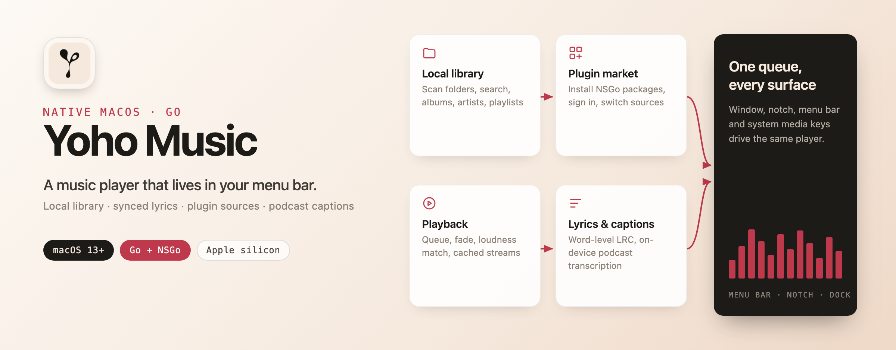
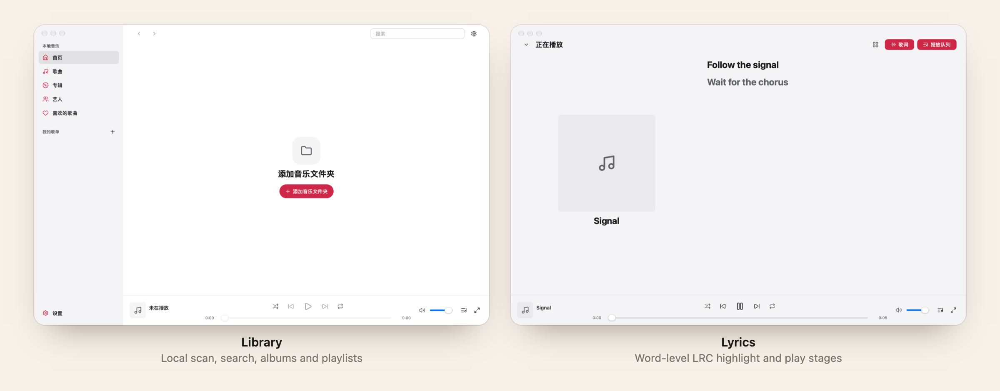

<p align="center">
  
</p>

<p align="center">
  A native macOS music player that lives in your menu bar — local library,<br>
  synced lyrics, plugin sources and podcast captions, all in one Go app.
</p>

<p align="center">
  <a href="#install">Install</a> ·
  <a href="#features">Features</a> ·
  <a href="#how-it-works">How it works</a> ·
  <a href="#development">Development</a> ·
  <a href="#license">License</a>
</p>

---

## Why Yoho Music

Most macOS players make you choose: a heavyweight library manager, a browser
wrapper, or a plugin system that never quite reaches the native shell. Yoho
Music is a single Go binary with a native UI, a plugin market for extra
sources, and a player that shows up wherever you already are — the window,
the menu bar, or the notch.

```text
Local folder  ─┐
Plugin source ─┼─▶  one queue  ─▶  window · notch · menu bar · media keys
Podcast feed ─┘
```

## Screens

<p align="center">
  
</p>

## Install

Grab a build for your architecture from [Releases](https://github.com/Yohoia/yoho-music/releases),
then open the DMG and drag **Yoho Music** into `/Applications`.
Requires macOS 13 or later.

Or build from source:

```sh
go tool nsgo build    # writes dist/releases/yoho-music-<version>-macos-<arch>.dmg
```

## Features

**Library** — scan local folders, search tracks, browse albums and artists,
build playlists, keep favourites.

**Playback** — queue, scrub, shuffle, repeat, crossfade, loudness
normalisation, streaming cache and session restore. Audio output runs on a
standalone audio package rather than a full browser stack.

**Lyrics** — synced LRC with word-level highlight. Play stages include Flow,
Steps and Tilt with optional sparks, plus a draggable cover wall, vinyl and
cassette. Light, dark and follow-system appearance; Simplified Chinese and
English.

**Everywhere** — menu-bar mini player, a top player that hugs the notch on
hover, native playback menu, and hardware media keys. Right-click the tray
icon or press `⌥⇧P` to summon the top player.

**Plugin market** — search and install plugins, import local signed NSGo
packages, sign in to each source, and switch where your music comes from.
Plugins plug into search, playlists, lyrics and streaming. Read the
[plugin interface and example](examples/nsgo-demo-plugin/README.md).

**Podcast captions** — models download on demand, transcription runs on your
machine during playback, and captions are stored per show.

## How it works

```text
  ┌──────────────┐  ┌──────────────┐  ┌──────────────────┐
  │   Library    │  │   Plugins    │  │ Lyrics · Caption │
  │ scan / index │  │  NSGo host   │  │ LRC · local ASR  │
  └──────┬───────┘  └──────┬───────┘  └────────┬─────────┘
         └─────────────────┴───────────────────┘
                           ▼
                 ┌───────────────────┐
                 │  Playback core    │
                 │ queue · fade · EQ │
                 └─────────┬─────────┘
                           ▼
      window · notch · menu bar · system media keys
```

The plugin host is sandboxed per plugin: each package gets its own account
session, its own macOS Keychain namespace through NSGo Secrets, and only the
capabilities it declares. A plugin may show a prompt or a QR code when you ask
it to sign in; it cannot read another plugin's credentials.

## Development

Requires Go 1.27.3 or later. NSGo and the build toolchain are pinned to `v0.2.0`.

```sh
go tool nsgo dev                              # run with live reload
go tool nsgo check -target macos_arm64,macos_x64
go tool nsgo test ./...
go tool nsgo build                            # produces dist/releases/*.dmg
```

Set `YOHO_MUSIC_DATA_DIR` to point the app at an isolated data directory.
The default is `~/Library/Application Support/Yoho Music`.

```text
main.go              entry point, calls app.Run
internal/app/        UI, playback state, plugin host and macOS integration
internal/i18n/       English keys and the Simplified Chinese catalog
internal/local/      folder scan, index and playlists
internal/lyrics/     LRC parsing and word-level timing
internal/music/      track metadata and artwork
internal/player/     decoding, queue, cache and streaming
internal/plugin/     NSGo plugin loading and source adapters
internal/speech/     on-device podcast transcription
assets/              app icon, tray and settings artwork
examples/            the NSGo demo plugin
```

### Status

Real third-party sign-in, hardware media keys, mixed-DPI and full-screen
spaces, Intel hardware, and the item-by-item visual pass are still pending
acceptance. See the [macOS port plan](docs/macos-port-plan.md) for full scope.

## Icon & license

Brand icons come from the [Yoho Music Figma spec](https://www.figma.com/design/okrazPUWhcUveq3gyM3gSN?node-id=2-12).
`assets/AppIcon.icns` is built from the 16–1024 px exports in
`assets/AppIcon.iconset` and used by the Dock and Finder. `assets/Icon.png` is
the 1024 px general icon. `assets/Tray.png` is a 36 px (18 pt @2×) menu-bar
template, and `assets/SettingsIcon.png` is a 60 px (30 pt @2×) settings icon.

The library, lyrics, playback and plugin-source interfaces under `internal/`,
the vinyl and cassette bitmap renderers, and the test tracks in the NSGo
example originate from MyGo Music `v0.1.25` by Egoist and contributors. Yoho
Music rewrites the interface, application lifecycle and plugin host, and wires
system media control into NSGo.

Licensed under GNU AGPL-3.0. MyGo's standalone audio library is MIT-licensed
and NSGo is Apache-2.0.

[Upstream source](https://github.com/egoist/mygo-music/tree/v0.1.25) ·
[License](LICENSE)
