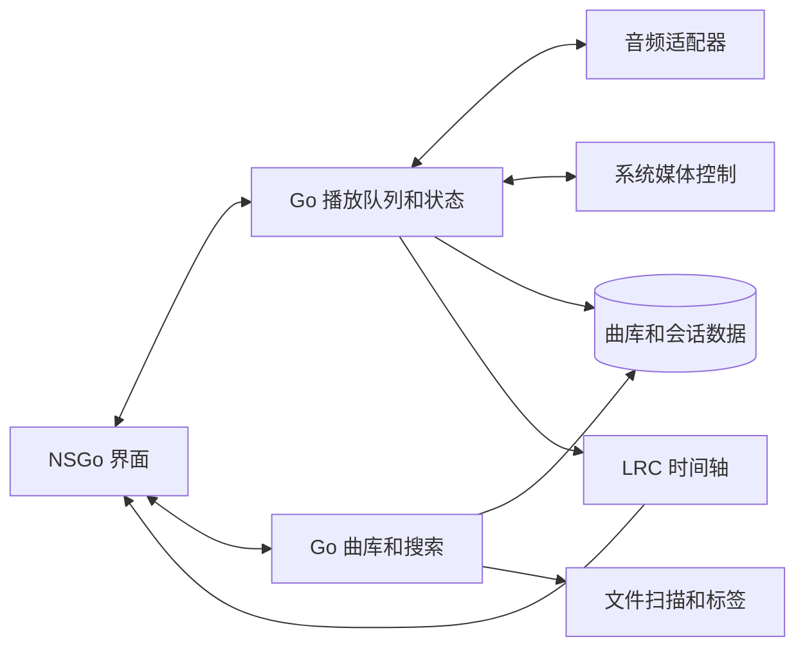

# Yoho Music 技术选型与 NSGo 迁移调研

Yoho Music 的目标是 **用 Go 和 NSGo 移植 MyGo Music macOS 版，逐项对齐原版的界面、交互和功能**。覆盖主窗口、播放页、设置、菜单栏和刘海播放器，也包括流式和远程播放、基于 NSGo 的 Yoho 音乐插件、播客字幕和会话恢复。可先用本地播放验证实现方式，完整对齐作为交付标准。

调研日期为 2026-11-23。最初对照了 MyGo Music 公开的 `main`，随后从 GitHub 下载并校验了 MyGo Music `v0.1.25` 和 NSGo `v0.2.0` 的官方源码包。本地有 Go 1.27.3、Apple Silicon 和 Xcode 27.2，播放与打包仍待运行验证。固定提交、工程步骤和验收标准见 [macOS 移植计划](macos-port-plan.md)。

以 MyGo Music `v0.1.25` 为验收基准。界面的像素对比以同一台 Mac、系统版本、窗口尺寸、显示缩放、主题、语言和播放状态为准。逐项记录差异，涉及品牌名称、图标或第三方素材的例外另行确认。功能验收用相同媒体样本和操作序列对照结果，插件使用 Yoho 的测试包。

## MyGo Music 的代码结构

| 模块 | 上游实现 | 对迁移的影响 |
| --- | --- | --- |
| 桌面与界面 | Go 1.27.3 和 `github.com/egoist/mygo v0.9.0`。`main.go` 调 `app.Run`，`internal/app` 管窗口、导航、播放器栏、菜单、托盘和界面状态。主界面使用 MyGo 自绘渲染。 | 用 NSGo 重写界面与应用生命周期。播放状态与窗口状态拆开，列表行和页面只订阅需要的值。[go.mod](https://github.com/egoist/mygo-music/blob/main/go.mod) · [app.go](https://github.com/egoist/mygo-music/blob/main/internal/app/app.go) · [渲染模型对比](https://nsgo.dev/docs/comparison.md#mygo) |
| 曲库与元数据 | `internal/music` 定义歌曲、专辑、歌单和来源接口。`internal/local` 后台扫描文件夹并发布内存目录快照，支持 MP3、FLAC、Ogg Vorbis、WAV、M4A、AAC。`scan.go` 用 `dhowden/tag` 读取标签，并依赖 MyGo 的 `audio/mp4`。 | 可延续异步扫描、增量索引和封面提取的行为。替换 MP4 元数据依赖或按它所属库的许可证单独评估选用。曲目身份与文件位置分开，文件移走或暂时不可读时仍能保留歌单关联。[music.go](https://github.com/egoist/mygo-music/blob/main/internal/music/music.go) · [local.go](https://github.com/egoist/mygo-music/blob/main/internal/local/local.go) · [scan.go](https://github.com/egoist/mygo-music/blob/main/internal/local/scan.go) |
| 播放 | `internal/player` 管队列、随机、循环、异步加载、下一首预取、淡入淡出和响度。它将解码后的流交给 `mygo/audio.NewPlayer`，还直接用 `mygo.NowPlaying` 处理系统媒体键、封面与播放进度。上游模块另依赖 MP3、Vorbis、AAC 等解码器。 | 队列规则、音频输出与系统媒体控制各有迁移工作。异步切歌需要避免旧曲目的完成、错误和进度事件覆盖新曲目。[player.go](https://github.com/egoist/mygo-music/blob/main/internal/player/player.go) · [stream.go](https://github.com/egoist/mygo-music/blob/main/internal/player/stream.go) · [MyGo `Decoder`](https://github.com/egoist/mygo/blob/v0.9.0/audio/audio.go) |
| 存储与缓存 | `library.json` 存用户的文件夹、收藏、歌单和历史。`index.json` 缓存标签，`covers/` 存封面。`settings.json` 与 `session.json` 单独保存，恢复时保持暂停。在线音频可边下载边播放，缓存按来源、曲目和音质标识，按容量清理。 | 移植时沿用 JSON 数据格式和缓存行为。需要导入旧用户数据时，保留旧文件和原有引用关系，重建索引与缓存。[local.go](https://github.com/egoist/mygo-music/blob/main/internal/local/local.go) · [settings.go](https://github.com/egoist/mygo-music/blob/main/internal/app/settings.go) · [session.go](https://github.com/egoist/mygo-music/blob/main/internal/app/session.go) · [cache.go](https://github.com/egoist/mygo-music/blob/main/internal/player/cache.go) |
| 歌词与系统集成 | LRC 解析和时间对齐位于 `internal/lyrics`。刘海定位使用 macOS `NSScreen` 和 `purego/objc`，托盘出现时关闭主窗口可继续播放。 | LRC 用纯 Go 实现，时间轴跟随播放位置。菜单栏可用 NSGo `desktop`，刘海定位仍需要 macOS 适配，播放实例须由应用生命周期持有。[lyrics.go](https://github.com/egoist/mygo-music/blob/main/internal/lyrics/lyrics.go) · [notch_darwin.go](https://github.com/egoist/mygo-music/blob/main/internal/app/notch_darwin.go) · [tray.go](https://github.com/egoist/mygo-music/blob/main/internal/app/tray.go) |
| 扩展与发行 | `internal/plugin` 通过 MoeJS 执行插件的 JS/TS，`plugin.json` 声明入口与能力，宿主提供 `host.*`、网络和授权进程接口。播客字幕走 Sherpa-ONNX 与可按需下载的 Qwen3-ASR。Bun 参与上游 mygo 配置和独立网站构建。 | Yoho 参考按能力提供音源的设计，使用 NSGo 的 TSX 运行时、能力模型和 `nsgo.yaml`。[plugin.go](https://github.com/egoist/mygo-music/blob/main/internal/plugin/plugin.go) · [MyGo Music README](https://github.com/egoist/mygo-music) · [发行流程](https://github.com/egoist/mygo-music/blob/main/RELEASING.md) · [NSGo 架构](https://github.com/nsgo-dev/nsgo/blob/main/ARCHITECTURE.md) |

## NSGo 可以承担的工作

- **界面与线程。** NSGo 的 Go 引擎维护响应式图和布局，按批次更新平台视图。macOS 后端经 `purego` 调 AppKit，AppKit 在主线程运行，响应式状态属于引擎 goroutine。歌曲扫描、数据库查询和播放器回调在其他 goroutine 完成时，用 `Scope.Post` 投递状态。组件通常建立一次，之后由 signal 更新依赖字段。曲库用虚拟列表，播放进度只驱动进度条和当前歌词。[架构](https://github.com/nsgo-dev/nsgo/blob/main/ARCHITECTURE.md) · [macOS 后端](https://github.com/nsgo-dev/nsgo/blob/v0.2.0/internal/platform/macos/macos.go) · [组件与状态](https://nsgo.dev/zh/docs/components/) · [列表与滚动](https://nsgo.dev/zh/docs/lists/)
- **桌面能力。** `desktop` 提供窗口、面板、菜单栏托盘和退出策略。托盘常驻场景用应用作用域管理播放，关窗再打开仍共享同一播放实例。媒体键、系统控制中心与应用内快捷键分别验收。macOS 系统媒体控制可单独桥接 `MPNowPlayingInfoCenter` 和 `MPRemoteCommandCenter`。[窗口和应用架构](https://github.com/nsgo-dev/nsgo/blob/v0.2.0/docs/architecture/application.md) · [Apple 播放信息](https://developer.apple.com/documentation/mediaplayer/mpnowplayinginfocenter) · [Apple 远程控制](https://developer.apple.com/documentation/mediaplayer/mpremotecommandcenter)
- **文件与凭证。** 文件对话框和应用数据目录优先用 NSGo 对应平台服务。对照原版验证目录选择、重启后读取、插件登录及权限提示。[平台服务](https://nsgo.dev/zh/docs/services/)
- **构建与测试。** 使用 `go tool nsgo init`、`dev`、`doctor`、`test`、`build` 和 `nsgo.yaml`。工具与框架固定为同一个已验证版本。业务规则用 Go 测试，界面交互用 `nsgotest`，设备的音频输出和媒体键用实际打包产物验证。正式 macOS 安装包用自己的应用 ID、Developer ID、签名与公证配置。[环境准备](https://nsgo.dev/zh/docs/getting-started/) · [测试](https://nsgo.dev/zh/docs/testing/) · [构建与发布](https://nsgo.dev/zh/docs/building/)

## 音频选型与版本差异

| 路线 | 可以做到 | 选用条件 |
| --- | --- | --- |
| NSGo `audio.Player` | `Play`、`Pause`、`Seek`、进度、缓冲和结束回调。`AudioSource` 接受 URI 或字节，`v0.2.0` 的这个接口没有自定义 HTTP 请求头或 PCM 输入字段。当前 `main` 的 Apple 后端走 AVFoundation。 | 先检查所选版本在 Mac 上 `Env.CanPlayAudio()` 返回真，并用样本验证播放。`v0.2.0` 公开了接口和测试替身，但该标签的路线图仍记录后端待交付。首轮以 `main` 的已测固定提交做验证，发布时再选择已包含后端的正式标签或继续固定该提交。[标签音频设计](https://github.com/nsgo-dev/nsgo/blob/v0.2.0/docs/architecture/audio.md) · [标签路线图](https://github.com/nsgo-dev/nsgo/blob/v0.2.0/docs/roadmap.md) · [标签 `AudioSource`](https://github.com/nsgo-dev/nsgo/blob/v0.2.0/core/audio.go#L12) · [main Apple 后端](https://github.com/nsgo-dev/nsgo/blob/main/internal/platform/apple/audio.go) |
| macOS 原生输出适配 | 通过 `purego` 或一个窄的原生桥接使用 AVFoundation `AVPlayer`，将曲目信息和系统媒体命令接回 Go 播放模块。 | 需要保持 NSGo 正式标签时，或 NSGo 自带后端达不到窗口生命周期和系统控制要求时使用。此路线让首版仍能采用 NSGo 界面。媒体键与控制中心须真机验收。[NSGo macOS 架构](https://github.com/nsgo-dev/nsgo/blob/main/ARCHITECTURE.md) · [Apple AVPlayer](https://developer.apple.com/documentation/avfoundation/avplayer) |
| Go 解码与 `audio.NewOutput` | Go 解码、重采样和应用层 DSP，向 NSGo 提供交错 Float32 PCM。可处理统一格式支持、频谱、响度、淡入淡出和无缝衔接。 | `v0.3.0` 已随正式版本发布该接口和多平台实现。首发需要控制 PCM 时，可在 worker 上解码，以有界缓冲连接音频回调，并测试缓冲欠载、跳转时清空缓冲和设备切换。[v0.3.0 输出接口](https://github.com/nsgo-dev/nsgo/blob/v0.3.0/audio/output.go) · [平台实现细节](https://github.com/nsgo-dev/nsgo/blob/main/docs/architecture/audio.md#pull-pcm-output) |

播放器选择以产品样本验证为准。通用测试格式选 WAV、MP3、AAC/M4A，FLAC、ALAC、Ogg Vorbis、ADTS AAC 和不同采样率按目标逐一测。需要自定义认证头或离线访问时，可由应用负责 HTTP 请求与文件缓存，再将可读文件交给播放后端。若还要求边下载边听和 HTTP Range 跳转，需要单独验收部分数据的读取与定位。[NSGo 平台解码说明](https://github.com/nsgo-dev/nsgo/blob/main/docs/architecture/audio.md#the-platforms) · [上游流式缓存](https://github.com/egoist/mygo-music/blob/main/internal/player/stream.go)

若首发就要复现桌面版的多格式播放行为，也可以单独评估 MIT 许可的 `github.com/egoist/mygo/audio` 作为过渡适配器。它提供 Go 解码和输出，MyGo Music 自己实现的缓存、预取与队列仍按应用仓库的 AGPL 许可证处理。接入前验证 `mygo/audio` 单独依赖时的桌面打包、设备切换和应用退出行为。[MyGo 音频源码](https://github.com/egoist/mygo/blob/v0.9.0/audio/audio.go) · [MyGo 框架许可证](https://github.com/egoist/mygo/blob/v0.9.0/LICENSE)

**移动端。** NSGo 的默认长音频播放器会在移动端退到后台时暂停。iOS 首发若要求锁屏继续听，需要把系统音频会话、后台 Audio 能力和 MediaPlayer 控制放到原生适配中验证。Android 对应验证 Media3 的 `ExoPlayer` 和 `MediaSessionService`。两端都需要真机测试来电和耳机断开，移动文件访问也有独立的生命周期。[NSGo 音频会话](https://github.com/nsgo-dev/nsgo/blob/main/docs/architecture/audio.md#sessions) · [Apple 播放会话](https://developer.apple.com/documentation/avfaudio/avaudiosession/category-swift.struct/playback) · [Android 后台播放](https://developer.android.com/media/media3/session/background-playback) · [NSGo 嵌入](https://nsgo.dev/zh/docs/embedding/)

## NSGo v0.3.0 兼容性核对

2026 年 11 月 23 日发布的版本提供 `audio.NewOutput`，并改进了 macOS 窗口释放、滚动与 WebView Cookie 处理。Yoho Music 的 Go 版本要求维持 1.27.3。兼容性实验在独立副本升级 Go 模块，更新 CLI 间接依赖后通过 Go 测试及两个 macOS 架构的静态检查和构建。将主窗口入口改为 `nsgo.SetMainView` 后，6 项 macOS 原生测试也全部通过。 [v0.3.0 发行说明](https://github.com/nsgo-dev/nsgo/releases/tag/v0.3.0)

GitHub 当前的 `v0.3.0` 标签源码与 Go 校验数据库接受的同版本模块存档有差异，其中包括 macOS 滚动实现。项目先保留 `v0.2.0` 和现有 MyGo 音频输出。启用 NSGo PCM 输出需要重新验证流式缓冲、定位、暂停淡出、媒体键和会话恢复。

## 移植技术栈与模块

| 部分 | 建议 |
| --- | --- |
| 界面 | NSGo `core`、`ui`、`desktop`，使用 Go 组件、signal 和虚拟列表。普通布局及交互先用 NSGo 组件和自定义样式复现。歌词舞台、封面墙和转场以原版效果为基准，必要时在 NSGo 内用 Canvas 或着色器实现。 |
| 曲库与歌词 | Go `os`、`io/fs`、`context`、`dhowden/tag`，纯 Go LRC 解析。异步扫描并按批提交，先覆盖标签缺失、同名歌曲、移动或删除文件。位置用稳定的曲目 ID 关联。 |
| 持久化 | 移植时优先沿用原版 JSON 格式和读写行为，便于用同一组曲库、设置、歌单和会话数据验收。SQLite 可作为后续独立改动。[曲库存储](https://github.com/egoist/mygo-music/blob/main/internal/local/local.go) · [会话存储](https://github.com/egoist/mygo-music/blob/main/internal/app/session.go) |
| 播放与媒体控制 | `Playback` 管队列、播放状态、进度、切歌与恢复，通过一个音频适配器控制设备播放。系统媒体控制适配器订阅同一播放状态并把系统命令送回 `Playback`。宿主由应用生命周期持有。 |
| 在线来源与插件 | 使用签名的 NSGo 插件包，按导出函数启用音源能力，以 Yoho 示例验证搜索、流式播放和登录。[插件说明](https://github.com/egoist/mygo-music#plugins) |

## 实施顺序和验收

1. **确定产品代码的复用方式。** MyGo Music 应用仓库为 AGPL-3.0，直接基于其代码改造并分发的衍生作品需按许可证处理声明、许可和对应源代码。可使用自己的产品名并收费。若希望保持闭源发布选项，独立实现产品代码或取得额外授权。底层 MyGo 框架为 MIT，NSGo 为 Apache-2.0，两者的许可证按各自实际引入的版本和文件核对。[MyGo Music AGPL 第 5、6 节](https://github.com/egoist/mygo-music/blob/main/LICENSE) · [MyGo MIT](https://github.com/egoist/mygo/blob/main/LICENSE) · [NSGo Apache-2.0](https://github.com/nsgo-dev/nsgo/blob/v0.2.0/LICENSE)
2. **建立原版对照基准。** 固定 macOS 参考版本，记录各页面、不同窗口尺寸、主题、动效、键鼠操作、空状态及错误状态。并行验证风险较高的歌词舞台、刘海窗口、媒体键与音频输出，再选定 NSGo 版本和需要的 macOS 适配。
3. **移植主窗口和本地曲库。** 按原版对齐侧栏、歌曲、专辑、歌单、搜索、设置及播放栏。用相同样本检查扫描去重、队列、快捷键、会话恢复及关闭窗口后继续播放等行为。
4. **移植其余功能。** 覆盖原版全部音频格式、流媒体缓存与预取、响度归一化与淡入淡出、歌词舞台与封面墙、托盘与刘海、插件兼容和播客字幕。用原版的输出行为逐项校验。
5. **验收并打包。** 对照静态截图和交互录屏，运行 Go 与 NSGo 测试，在 macOS 上验证安装包、媒体键、输出设备切换以及外接屏和全屏场景。记录实测差异和结论。
